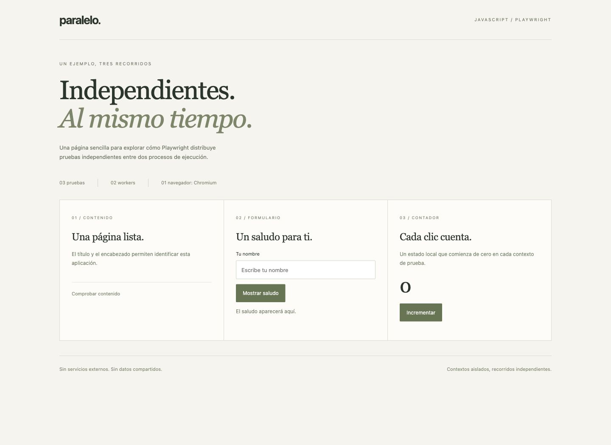
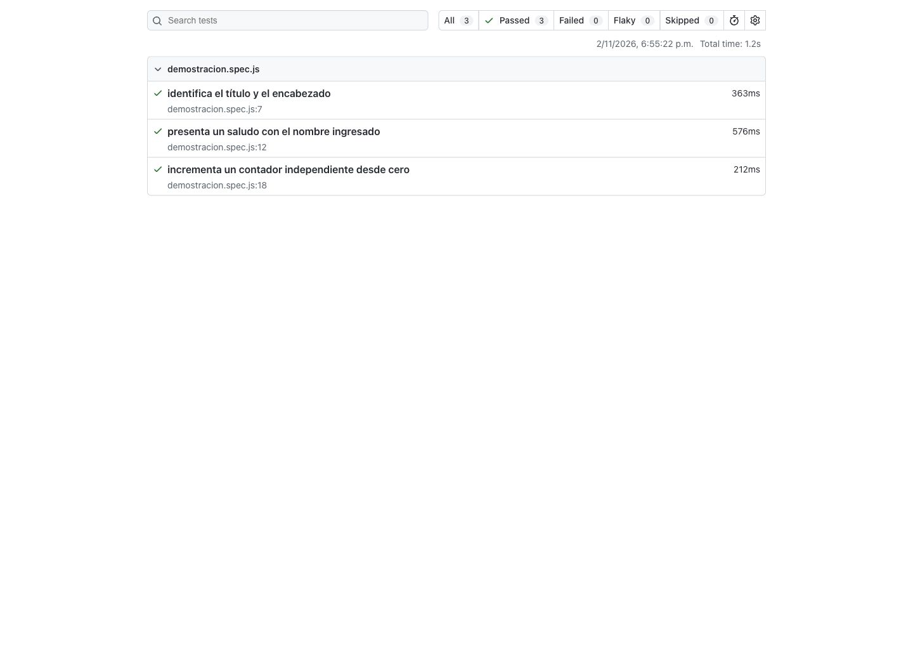
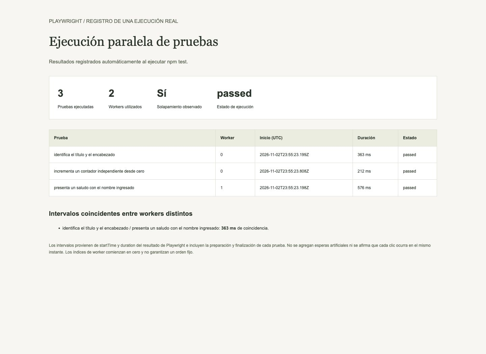

<div align="center">
  <table>
    <thead>
      <tr>
        <th>
          
        </th>
        <th>
          <strong>UNIVERSIDAD LA SALLE DE AREQUIPA</strong><br />
          <strong>FACULTAD DE INGENIERÍAS Y ARQUITECTURA</strong><br />
          <strong>DEPARTAMENTO ACADÉMICO DE INGENIERÍA Y MATEMÁTICAS</strong><br />
          <strong>CARRERA PROFESIONAL DE INGENIERÍA DE SOFTWARE</strong>
        </th>
      </tr>
    </thead>
  </table>
</div>

<div align="center">
  <h1>EJECUCIÓN PARALELA DE PRUEBAS</h1>
  <strong>Tecnologías de Construcción de Software</strong><br />
  <strong>Profesor: Luis Enrique Patiño Herrera</strong>
</div>

---

## Descripción

Ejemplo de ejecución paralela de pruebas automatizadas con **Playwright y JavaScript**. La aplicación local ofrece tres recorridos independientes: identificar su contenido, completar un formulario de saludo e incrementar un contador.

Las pruebas se distribuyen entre **dos workers** y cada una recibe un contexto de navegador aislado. Se generan un reporte HTML oficial y un registro con los tiempos reales de cada prueba para identificar intervalos coincidentes entre workers distintos.

## Tecnologías utilizadas

[](https://developer.mozilla.org/es/docs/Web/HTML)
[](https://developer.mozilla.org/es/docs/Web/CSS)
[](https://developer.mozilla.org/es/docs/Web/JavaScript)
[](https://nodejs.org/)
[](https://playwright.dev/)

- **HTML** y **CSS** para la página local de demostración.
- **JavaScript** con módulos, funciones y variables propias en español.
- **Node.js** para ejecutar Playwright, iniciar el servidor HTTP y escribir los reportes.
- **Playwright Test 1.64.1** como única dependencia directa de desarrollo, con versión exacta.
- **Chromium** instalado por Playwright como navegador de las pruebas.

Node.js sí es necesario en este proyecto: ejecuta el runner de pruebas y el servidor local. La página funciona en el navegador. No se utiliza Python ni se requieren servicios externos durante las pruebas, una vez instaladas las dependencias y el navegador.

El logo y las insignias de este README requieren conexión para visualizarse. La aplicación no depende de ellos.

## Ejecución

Requisito: Node.js 24. Instalar dependencias y el navegador:

```bash
git clone https://github.com/iamrodrigodev/ejecucion-paralela-de-pruebas.git
cd ejecucion-paralela-de-pruebas
npm ci
npx playwright install --no-shell chromium
```

Ejecutar las pruebas:

```bash
npm test
```

Playwright inicia y detiene automáticamente el servidor de la aplicación en `http://127.0.0.1:8002`. El puerto debe estar libre al ejecutar las pruebas.

Para utilizar manualmente la página:

```bash
npm start
```

Detener ese servidor antes de ejecutar `npm test`.

Para abrir el reporte HTML oficial después de ejecutar las pruebas:

```bash
npm run report
```

Para abrir el resumen de intervalos, abrir `evidencias/resumen.html` en el navegador. También se puede inspeccionar `evidencias/ejecucion.json`.

## Funcionamiento

### Ejecución paralela en Playwright

```javascript
fullyParallel: true,
workers: 2,
retries: 0
```

- **`fullyParallel: true`** permite distribuir también las pruebas del mismo archivo entre workers. Sin esta opción, las pruebas de un mismo archivo se ejecutan en serie de forma predeterminada.
- **`workers: 2`** limita a dos procesos de trabajo simultáneos. No significa dos hilos dentro de la página ni dos Web Workers del navegador.
- Cada worker ejecuta su navegador y cada prueba dispone de un contexto aislado. El formulario y el contador de una prueba no comparten estado con las demás.
- Con tres pruebas y dos workers, hasta dos pruebas pueden ejecutarse a la vez; otra puede comenzar cuando un worker quede disponible. El orden no está garantizado.
- No se utilizan dependencias entre pruebas, estado global compartido ni pausas artificiales para simular el paralelismo.

[Documentación oficial de paralelismo](https://playwright.dev/docs/test-parallel).

### Ejemplo implementado

| Prueba | Acciones | Resultado esperado |
|---|---|---|
| Contenido | Abrir la aplicación. | Título y encabezado esperados. |
| Formulario | Escribir Lucía y enviar. | `Hola, Lucía.` |
| Contador | Verificar cero y pulsar dos veces. | Valor final `2`. |

Las aserciones de Playwright esperan las condiciones de la interfaz. Cada prueba abre la página desde cero y no depende de que otra se ejecute primero.

### Organización y buenas prácticas

| Archivo | Responsabilidad |
|---|---|
| `dominio.js` | Funciones puras para crear el saludo e incrementar un valor. |
| `vista.js` | Adaptador del DOM con elementos recibidos por constructor. |
| `aplicacion.js` | Composición de la vista, las reglas y los eventos. |
| `servidor.js` | Servidor HTTP local con una lista explícita de recursos permitidos. |
| `index.html` y `estilos.css` | Estructura y diseño de la demostración. |
| `demostracion.spec.js` | Tres pruebas de interfaz independientes. |
| `playwright.config.js` | Workers, aislamiento, reportes y servidor automático. |
| `reporte-paralelo.js` | Adaptador de evidencia sobre los eventos del runner. |

La organización aplica responsabilidad única, separación entre reglas y presentación y dependencias explícitas. Se evita añadir capas o bibliotecas sin una responsabilidad concreta. Las APIs nativas conservan sus nombres; las variables, funciones y clases propias se nombran en español.

El `package.json` tiene únicamente los scripts necesarios y una dependencia exacta. `package-lock.json` fija el árbol de dependencias; `npm ci` reproduce esa instalación.

## Resultado esperado

La terminal debe indicar que se ejecutan tres pruebas utilizando dos workers y finalizar con tres pruebas aprobadas.

Los archivos `evidencias/ejecucion.json` y `evidencias/resumen.html` se regeneran a partir de cada ejecución real. Incluyen los workers utilizados, estado, inicio, duración y coincidencias entre intervalos. No son resultados escritos manualmente.

Los intervalos se calculan desde `startTime` y `duration` de Playwright e incluyen preparación y finalización. Un solapamiento entre workers demuestra concurrencia de las pruebas, no que cada instrucción ocurra al mismo instante ni una mejora de velocidad medida. En ejemplos pequeños el costo de iniciar procesos puede superar el ahorro de tiempo.

### Ejecución registrada

En la ejecución documentada aprobaron las tres pruebas en aproximadamente 1,2 segundos. Se utilizaron los workers 0 y 1 y se observaron 363 ms de coincidencia entre las pruebas de contenido y formulario. Estos valores proceden de `evidencias/ejecucion.json` y pueden variar al repetir la ejecución.

## Comprobación

```bash
npm test
npm run report
```

El reporte HTML oficial presenta resultados y capturas de cada prueba. El resumen complementario permite inspeccionar la distribución entre workers y el solapamiento observado.

[Documentación oficial de reportes](https://playwright.dev/docs/test-reporters).

## Evidencia de la ejecución

Las capturas siguientes corresponden a una ejecución real. Los tiempos pueden variar al repetirla.

### Página de demostración



### Reporte oficial de Playwright



### Workers e intervalos coincidentes



Los reportes completos de Playwright, sus trazas y los archivos temporales se generan localmente y se excluyen de Git. El repositorio conserva el resumen de la ejecución y las capturas explicativas.
